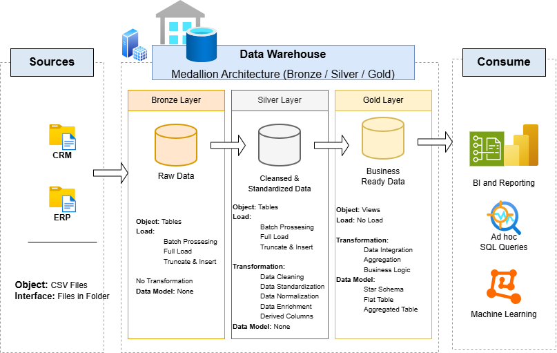

# SQL Server Data Warehouse Project

A data warehouse built in **SQL Server** using the **Medallion architecture** (Bronze, Silver, Gold). It combines customer, product and sales data from two source systems (CRM and ERP) into a clean **star schema** ready for analytics and reporting.

> **Credit:** Built by following the [Data with Baraa](https://www.youtube.com/@DataWithBaraa) SQL data warehouse tutorial (MIT license). I added my own comments, logging and error handling, diagrams and data-quality fixes.



## Highlights

- **Bronze:** loads 6 raw CSV files (CRM and ERP) with `BULK INSERT`
- **Silver:** cleans and standardizes the data (deduplication, date conversion, code decoding, derived columns)
- **Gold:** star schema views: `dim_customers`, `dim_products` and `fact_sales`
- Reloadable stored procedures with load timing and `TRY...CATCH` error handling

## Quick start

1. Create a database with `bronze`, `silver` and `gold` schemas
2. Run the DDL and load scripts in `scripts/` (Bronze, then Silver, then Gold)
3. Query the Gold views, for example `SELECT * FROM gold.fact_sales;`

## Full documentation

Architecture, data sources, data flow, transformations, data model, setup steps and the data-quality issue I fixed are in **[docs/project_documentation.md](docs/project_documentation.md)**.

## Repository structure

```
├── datasets/    # source CSV files (CRM and ERP)
├── docs/        # documentation and diagrams
├── scripts/     # bronze, silver and gold SQL scripts
├── LICENSE
└── README.md
```

## About me

I'm Kulsoom, a recent graduate with a B.S. in Information Technology from George Mason University (concentration in Database Programming and Technology). I'm interested in data and database work: writing SQL, building clean data pipelines, and turning raw data into insights that support decisions.

Before moving into data, I spent 6 years as a **home health aide**, which gave me hands-on experience in healthcare, careful documentation, and working with patients, families and care teams. I'm now combining that background with my technical skills and looking for **entry-level and junior data analyst and analytics roles, especially in healthcare**. This project is part of my hands-on practice with data warehousing.

I'm bilingual, which helps me communicate with diverse teams and clients.

**Connect with me:** [LinkedIn](https://www.linkedin.com/in/kulsoom-bibi-2a3654278/) | [GitHub](https://github.com/kbibi2002) | [Email](kbibi2533@gmail.com) | Phone: 5712959747
